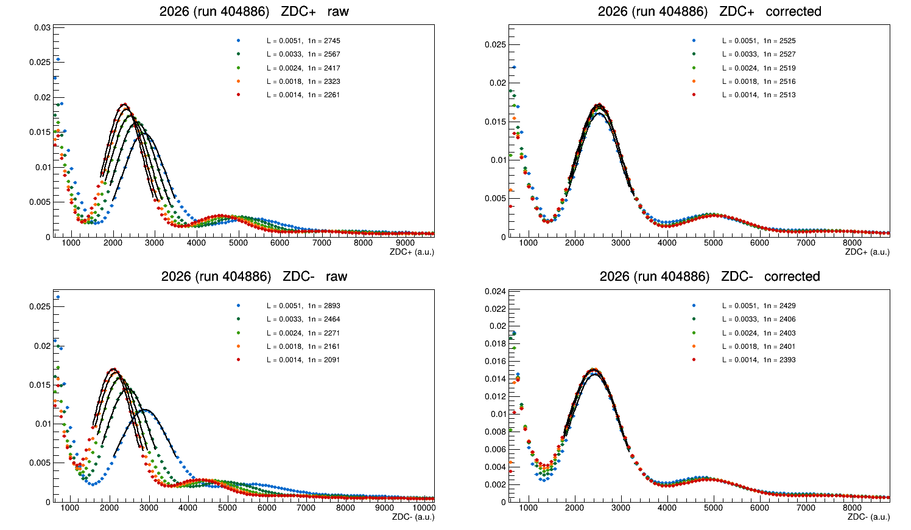

# ZDC luminosity correction — Run 3 PbPb (2023–2026)

The CMS ZDC energy scale depends on instantaneous luminosity. Across a single
fill the 1n neutron peak moves by up to **+57 %**, so a cut placed at a fixed
value in raw units selects a different physical energy at the start of a fill
than at the end. This repository provides a correction that removes it, the
code that derived it, and the tests that show it works.



Five slices of one run, in order of decreasing luminosity. Raw (left) the 1n
peak marches from 2893 to 2091; corrected (right) the same five slices sit on
top of each other, 2393–2429.

---

## Using it (this is all most people need)

`include/ZDCLumiCorrection.h` is header-only with no framework dependency, so
the same file works in a ROOT macro and inside an EDAnalyzer or EDProducer.

```cpp
#include "ZDCLumiCorrection.h"

ZDCLumiCorrection zdcCorr;
zdcCorr.addLumiTable("data/lumi_byls_2025HI.csv");   // once, per year you use

// per event
double zp = zdcCorr.correct(run, lumi, ZDCLumiCorrection::Plus,  zdcPlusRaw);
double zm = zdcCorr.correct(run, lumi, ZDCLumiCorrection::Minus, zdcMinusRaw);
if (!zdcCorr.valid()) {
  // no luminosity for this lumi section: the RAW value was returned, uncorrected
}
```

The correction is

```
ZDC_corr = ZDC_raw * muRef / mu1(L)
```

where `mu1(L)` is the measured 1n peak position, fitted with a cubic per year
and per side, and `muRef` is its value at L = 0.003 /µb/s.

**Quote neutron cuts as a fraction of `muRef`, not as absolute numbers.** The
reference differs per year (ZDC+: 2525 in 2024, 2694 in 2025, 2551 in 2026).
`zdcCorr.muRef(run, side)` returns it. The recommended Xn working point is
about 0.44·muRef, which sits in the valley between the 0n and 1n populations.

### What it does and does not do

This is a **single-parameter** correction tuned on the 1n peak. It is what an
Xn (≥1 neutron) selection needs: the 1n peak lands at a fixed place and the
valley below it moves with the peak, so a cut at a fixed fraction of `muRef`
keeps a fixed efficiency at every luminosity.

It does **not** make the neutron peaks correctly *spaced*. If you are counting
neutrons — 1n vs 2n vs 3n — you need the two-component form with an offset b(L)
and a per-neutron scale k(L); `tools/fitLumiDep.C` extracts both.

### Supported run ranges

| years | runs | notes |
|---|---|---|
| 2023 | 374288–375823 | scale is nearly flat in L (~1–2 % total); correction barely needed |
| 2024 | **388556–388784 only** | see below |
| 2025 | 399465–400426 | |
| 2026 | 404469–404926 | ZDC+ saturates above L ≈ 0.0045; the cubic follows it, but treat ZDC+ there with care |

Runs outside these ranges return the raw value with `valid() == false`. Nothing
is silently scaled by the wrong factor.

**2024 before run 388556 is deliberately unsupported.** That period contains
three different ZDC calibration states, and the CMS dataset boundaries do not
coincide with them:

| state | 1n− | 1n+ | −/+ | runs |
|---|---|---|---|---|
| low | ~2500 | ~2100 | 1.19 | 387892–387908, and 387985 from lumi section 355 |
| high | 3633–4233 | 3033–3500 | 1.25 | 387973–388476 |
| final | 2433–2767 | 2433–2700 | **1.00** | 388556–388784 |

Within the "high" state the 1n peak scatters ±8 % run to run *at fixed
luminosity*, so a luminosity fit there mixes several scales in every bin. Run
387985 changes state in the middle of the run. Recovering that period needs a
per-run normalisation applied first; it has not been done.

---

## Validating it yourself

```bash
root -l -b -q 'examples/validateCorr.C("<skim>.root",399942,"data/lumi_byls_2025HI.csv","2025",0x8,5)'
```

This slices one run into five luminosity ranges and overlays the spectra, raw
and corrected (the figure at the top of this page). Measured results:

| run | ZDC+ raw spread | corrected | ZDC− raw spread | corrected |
|---|---|---|---|---|
| 2025, 399942 | 25 % | **0.9 %** | 34 % | **1.1 %** |
| 2026, 404886 | 21 % | **0.6 %** | 38 % | **1.5 %** |

Two things worth checking in the output, because they are not fitted and so are
genuine tests rather than closure: the **2n peak** lines up as well as the 1n
peak, and so does the **valley** between 0n and 1n, which is where an Xn cut
lives.

A second, stronger test is in `tools/closure.C`: derive the correction on one
long run and apply it to a *different* long run from a different fill. A raw
drift of 21–58 % comes out at 0.1–3.8 %.

---

## Rebuilding the correction from scratch

Only needed if you want to re-derive the parameters, extend to a new year, or
check the inputs.

### 1. Produce per-event trees

`cmssw/` holds the CMSSW analyzer and configurations. Build against
**CMSSW_16_1_3** (`el9_amd64_gcc13`) — 2026 MINIAOD is written with 16_1_1 and
cannot be read by 15_1_x.

```bash
cmsrel CMSSW_16_1_3 && cd CMSSW_16_1_3/src && cmsenv
# copy cmssw/ into FlowCorrAna/DiHadronCorrelationAnalyzer, then
scram b -j 8
```

`cfg/crabConfig_ZDC_MultiYear.py` submits one CRAB task per dataset. The tree is
deliberately small — `run`, `lumi`, `zdcPlus`, `zdcMinus`, `nPixel`, `bx`,
`nVtx`, `trigBits`, about 7 bytes/event — so a full primary dataset is ~10 GB.

2023 is the exception: it has no usable centrality object, so the ZDC sum is
rebuilt from QIE10 digis as (TS2 − TS1) per channel with the 2023 electronics
map (`cmssw/data/emap_2023_newZDC_v3.txt`), through
`cfg/ZDC_2023_MINIAOD_cfg.py`. Its branches are `zdcPlusDigiId` /
`zdcMinusDigiId`.

### 2. Luminosity tables

Per-event luminosity is **not** in MINIAOD (`LumiScalers` is present but empty;
`OnlineLuminosityRecord` is absent), so it comes from a brilcalc table joined on
(run, lumiSection):

```bash
brilcalc lumi -c web -i data/json/<golden>.json --byls -u /ub -o lumi_byls_<YEAR>HI.csv
```

Field 5 is the luminosity **delivered per lumi section**; one lumi section is
23.31 s, so L = field5 / 23.31 in /µb/s. That division is done inside the code —
pass the csv exactly as brilcalc writes it. Tables for all four years are in
`data/`.

For 2023 use the **ZDC-specific** certification JSON
(`Cert_Collisions2023HI_374288_375823_Good_ZDC_Golden.json`), not the plain
golden one. It keeps 62 of 93 runs, and the 31 it drops include eight runs whose
digi sum reconstructs to nothing at all. No ZDC-specific JSON exists for
2024–2026.

### 3. Spectra in luminosity bins, then the fit

```bash
root -l -b -q 'tools/lumiSpectra.C("<tree>.root","data/lumi_byls_2026HI.csv","lumispectra_2026.root","2026",0,3)'
root -l -b -q 'tools/muFit.C("2026","ZDCOR",0.0010,0.0060)'
```

`lumiSpectra.C` writes (L, ZDC) maps — which *are* the set of 1D spectra, one
projection per bin — so every later fit runs in seconds instead of re-reading a
12 GB tree. Bins are 0.0001 wide below L = 0.003 and 0.0002 above, with the ZDC
axis to 24000 so the 3n peak is in range.

`muFit.C` prints the cubic coefficients in the form used by the header, plus the
maximum deviation of the fit from the measured points — which is the quantity
that becomes the residual of the correction, and a more useful number than
χ²/ndf (the statistical errors on µ₁ are a few parts in 10⁴, so χ²/ndf is large
for any smooth curve).

Other tools: `fitLumiDep.C` (b(L) and k(L) from the 1n–2n spacing),
`paramLumi.C` (compare linear and quadratic forms for b and k), `runscale.C`
(locate calibration changes by scanning the 1n peak per run **at fixed
luminosity** — holding L fixed is what separates calibration from drift),
`skimRuns.C` / `skim2.C` (skim one or two runs into a small file; both reuse an
existing skim rather than regenerate it).

---

## How good is it, honestly

| year | side | cubic reproduces µ₁(L) to |
|---|---|---|
| 2024final | ZDC+ / ZDC− | 0.9 % / 0.8 % |
| 2025 | ZDC+ / ZDC− | 2.3 % / 2.3 % |
| 2026 | ZDC+ / ZDC− | 1.1 % / 0.5 % |
| 2023 | ZDC+ / ZDC− | 1.3 % / 2.1 %, consistent with statistics alone |

2025 is the worst because its µ₁(L) has a gentle S-shape that no polynomial
follows — a quadratic is actually *worse* there than a straight line. A
tabulated µ₁(L) with interpolation would be exact in all years and is the
obvious upgrade if ~2 % is not good enough.

Luminosity is confirmed to be the controlling variable, not time: in runs with a
long luminosity **levelling plateau** the peak sits still for hundreds of lumi
sections while time advances, and only starts moving when the luminosity begins
to decay. Two runs from different fills, with different luminosity profiles,
give 1n peak positions falling on a single curve against L.

### What is not understood

The correction is empirical. The drift decomposes as µₙ = b(L) + n·k(L), and:

- **b(L)** behaves like a mis-subtracted pedestal — negative at low rate,
  positive at high rate, crossing zero mid-range. The reconstruction subtracts a
  *static* pedestal from conditions while the true baseline rises with rate, as
  measured directly in no-collision bunch crossings.
- **k(L)**, the per-neutron scale, rises 16–39 %, and no baseline shift of any
  size can do that — adding a constant to every channel moves all peaks equally
  and leaves their spacing alone. The leading candidate is the zero-suppression
  clamp in `subPedestal`: channels near the suppression threshold are released as
  the baseline rises, so the same deposit reconstructs higher, non-linearly in
  deposit size. **That test has not been run**, and if it is confirmed the fix
  belongs in the reconstruction rather than here.

Supporting evidence: 2023, whose ZDC sum uses a **local** baseline (TS2 − TS1 in
the same channel in the same event) rather than a static conditions pedestal,
shows essentially no drift — 1–2 % against 27–57 % in 2025 and 2026.
